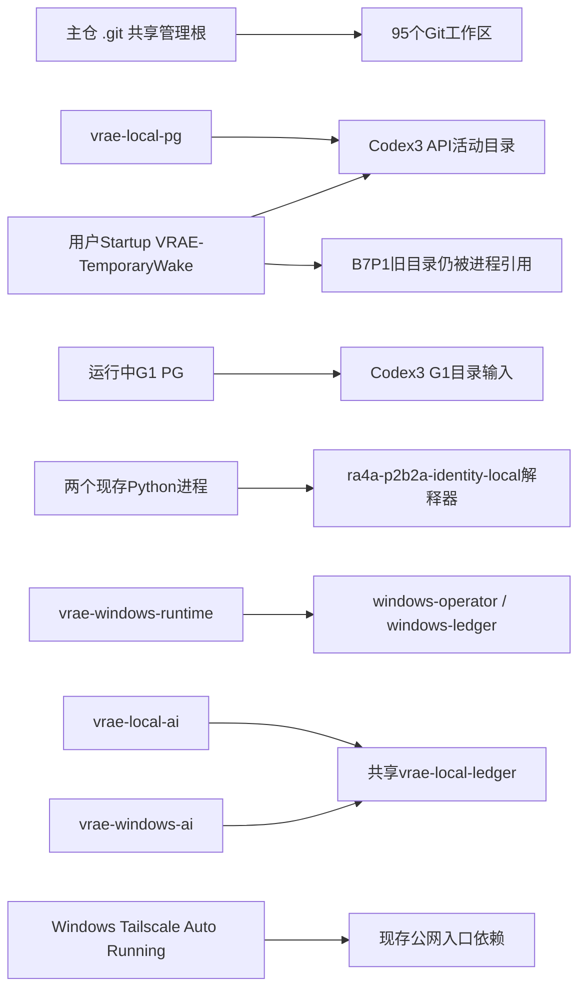

# 运行依赖保护清单 · Issue #175 · Phase A

元数据起点：2026-11-20T01:43:33.944461+00:00；终验：2026-11-20T01:54:22.644015+00:00。
只用Docker筛选后的Mounts/State/Image/RestartPolicy、Windows进程/服务/计划任务/启动快捷方式/Run键路径摘要。
不读Config.Env、原始命令行输出、容器文件、Tailscale配置或任何volume内容；没有exec/stop/restart/up/prune。
镜像未提供可用OCI revision标签，故**不能从镜像ID推定实际服务源码SHA**；审计PR SHA也不是运行readback。

## 宿主目录保护

| ID | 目录 | 实证与误删后果 |
| --- | --- | --- |
| P001 | `D:/Projects/VRAE` | 唯一共享.git object store/refs/worktree管理根；删除会破坏整个95工作区家族；processes: WindowsTerminal.exe PID 30976；processes: pythonw.exe PID 36620；processes: python.exe PID 9196；processes: pythonw.exe PID 21868；processes: python.exe PID 4756；startup: VRAE-TemporaryWake.lnk；误删可能中断进程、重启/恢复或Git访问 |
| P044 | `D:/Projects/VRAE-codex3-API-20261119` | startup: VRAE-TemporaryWake.lnk；容器输入绑定: vrae-local-pg；PR172与VF联调活动树，不入内；启动/构建/后续运维源必须保留；误删可能中断进程、重启/恢复或Git访问 |
| P047 | `D:/Projects/VRAE-codex3-B7P1` | processes: WindowsTerminal.exe PID 30976；processes: pythonw.exe PID 36620；processes: python.exe PID 9196；processes: pythonw.exe PID 21868；processes: python.exe PID 4756；startup: VRAE-TemporaryWake.lnk；误删可能中断进程、重启/恢复或Git访问 |
| P052 | `D:/Projects/VRAE-codex3-G1-20261118` | 容器输入绑定: vrae-g1-eb9ece101767-pg；误删可能中断进程、重启/恢复或Git访问 |
| P086 | `D:/Projects/VRAE/.worktrees/ra4a-p2b2a-identity-local` | processes: python.exe PID 30636；processes: python.exe PID 22068；误删可能中断进程、重启/恢复或Git访问 |

## 容器元数据（全部保留；不是清理目标）

| 名称 | 状态 | 镜像ID | 重启策略 | named volume/受保护宿主根 |
| --- | --- | --- | --- | --- |
| vrae-windows-relay | running | `be2711e41bfb` | unless-stopped | 无卷/宿主挂载；镜像与运行仍须保留 |
| vrae-windows-ai | running | `be2711e41bfb` | unless-stopped | vrae-local-ledger (RW); vrae-windows-operator (RO) |
| vrae-windows-runtime | running | `be2711e41bfb` | unless-stopped | vrae-windows-ledger (RW); vrae-windows-operator (RO) |
| vrae-windows-source-web | running | `f2e6430ae524` | unless-stopped | vrae-windows-source-state (RO) |
| vrae-local-ai | running | `0b2e084bf7d4` | unless-stopped | vrae-local-ledger (RW); vrae-local-operator (RO) |
| vrae-local-runtime | running | `0b2e084bf7d4` | unless-stopped | vrae-local-ledger (RW); vrae-local-operator (RO) |
| vrae-local-c1-model-caller | running | `97be470ef819` | no | vrae-local-c1-model-caller-material (RO); vrae-local-c1-model-caller-material (RW) |
| vrae-windows-source | running | `72c1e19e0aed` | unless-stopped | vrae-windows-source-state (RW) |
| vrae-windows-pg | running | `721873c34ceb` | unless-stopped | 输入背后卷: vrae-windows-private; vrae-windows-data (RW) |
| vrae-local-relay | running | `96953abea316` | unless-stopped | 无卷/宿主挂载；镜像与运行仍须保留 |
| vrae-local-pg | running | `721873c34ceb` | unless-stopped | D:/Projects/VRAE-codex3-API-20261119; 输入背后卷: UNKNOWN_PROTECT; vrae-local-data (RW) |
| vrae-g1-eb9ece101767-runtime | running | `2788ce8c1596` | no | vrae-g1-eb9ece101767-evidence (RW); vrae-g1-eb9ece101767-source (RO) |
| vrae-g1-eb9ece101767-pg | running | `721873c34ceb` | no | D:/Projects/VRAE-codex3-G1-20261118; 输入背后卷: UNKNOWN_PROTECT; vrae-g1-eb9ece101767-data (RW) |
| vrae-ra1a-acceptance | exited | `5521a256c40a` | no | 无卷/宿主挂载；镜像与运行仍须保留 |

两个AI容器都显示同一vrae-local-ledger挂载；这里只说明共享可变依赖，**没有检查账本内容或推断并发调用**。不得因“重复AI”自行停止、迁移或清空任一卷。
Windows服务的API/Worker可能在同一runtime进程树内，未exec故未独立核验内部Worker数量，不冒称已验证单Worker。
镜像大小为共享层口径，不是可释放量；所有现存镜像与VHDX不在Phase A清理提案内。

## 命名卷保护

| 卷名 | 保护级别 | 内容/容量 |
| --- | --- | --- |
| `vrae-g1-eb9ece101767-data` | A_现存容器引用/不可动 | 未读取，容量UNKNOWN，不计释放量 |
| `vrae-g1-eb9ece101767-evidence` | A_现存容器引用/不可动 | 未读取，容量UNKNOWN，不计释放量 |
| `vrae-g1-eb9ece101767-source` | A_现存容器引用/不可动 | 未读取，容量UNKNOWN，不计释放量 |
| `vrae-local-c1-model-caller-material` | A_现存容器引用/不可动 | 未读取，容量UNKNOWN，不计释放量 |
| `vrae-local-data` | A_现存容器引用/不可动 | 未读取，容量UNKNOWN，不计释放量 |
| `vrae-local-ledger` | A_现存容器引用/不可动 | 未读取，容量UNKNOWN，不计释放量 |
| `vrae-local-operator` | A_现存容器引用/不可动 | 未读取，容量UNKNOWN，不计释放量 |
| `vrae-windows-backups` | E_UNKNOWN_PROTECT（私有根/备份仍需保留） | 未读取，容量UNKNOWN，不计释放量 |
| `vrae-windows-data` | A_现存容器引用/不可动 | 未读取，容量UNKNOWN，不计释放量 |
| `vrae-windows-ledger` | A_现存容器引用/不可动 | 未读取，容量UNKNOWN，不计释放量 |
| `vrae-windows-operator` | A_现存容器引用/不可动 | 未读取，容量UNKNOWN，不计释放量 |
| `vrae-windows-private` | A_现存容器引用/不可动 | 未读取，容量UNKNOWN，不计释放量 |
| `vrae-windows-source-state` | A_现存容器引用/不可动 | 未读取，容量UNKNOWN，不计释放量 |

即使卷未在某个容器的Mounts中出现，也不表示可删：root私有卷可通过文件级bind或仅由受信操作者/备份流程使用。
未读取Docker宿主mountpoint、私有卷文件、备份内容或ledger数据库；容器内敏感输入路径已遮蔽。

## Windows启动/服务与盲区

Tailscale服务Running/Auto；用户Startup有VRAE-TemporaryWake.lnk，全用户Startup有Tailscale.lnk。
VRAE相关已观察计划任务/Run键匹配为0；这只说明该次查询没有匹配，不保证不存在其他登录用户、相对路径、变量拼接、人工命令或远程调度。
两个tailscaled进程的命令信息不可见；Tailscale节点/路由配置未读取。不能为了补足审计关闭VPN或调整路由。
普通项目目录没有观察到引用并非对所有潜在消费者的数学证明；D候选还需Owner在批准窗口逐项复核。
当前活动树大小与dirty/untracked/ignored未知；未进入它，也未要求Codex3暂停联调。备份任务存在性/私有恢复链内容未取证，按UNKNOWN_PROTECT。
本轮没有启动、停止、重启或部署任何容器/进程，没有运行模型或更改系统启动入口。
