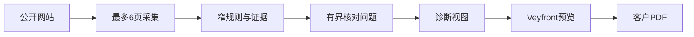

# 把真实预诊断做成可谈话的 L2 判断

## 现状

顶层约束不变，见 [PRODUCT_CHARTER_V1.1.md](docs/00-product/PRODUCT_CHARTER_V1.1.md) 和 [L2_V1.1_CHARTER_SUPPLEMENT.md](docs/03-engineering/l2-v1.1/L2_V1.1_CHARTER_SUPPLEMENT.md)。L2 是分析深度，不是更高抓取权限。客户只看见 Veyfront。客观缺陷必须有证据；没看到的写未知，不能凑成问题，也不能给总分、损失或报价。

现网客户稿走 `GET /v1/audits/{audit_ref}/diagnosis`，不是正式报告口。文案在 [presentation.py](integration/authorized_targets/presentation.py)，展示分组在 [report-view.mjs](integration/authorized_targets/consumer/report-view.mjs)。正式人审仍是独立的 `/v1/report-authority/.../report`。内部 DeepReport 和 RebuildBrief 不在这条客户链上。

最新 PDF（`www.beherohome.com`，2026-11-21，6 页已访问、71 个候选未访问、0 次失败）说明管道是通的，而且证据边界守住了：没有把并列选项写成库存或标准规格，也没有把未知算成缺陷。它仍然不能交给客户，原因是读完没有判断。

- 标题写「本次未确认具体缺陷」，下一屏又把唯一一条 AI 核对问题抬成「建议优先关注」，并配上「可以先这样改」。没有证实缺陷时，这条砂轮结合剂/粒度的并列写法只是待供方确认的问题，不是优先改造项。
- 五个环节用的是引擎句子。已通过的四条几乎是 [presentation.py](integration/authorized_targets/presentation.py) 里的原文：「已记录静态链接」「未核验产品身份」。核对企业资料、访问与页面结构被收成「已有部分页面记录，此环节仍需核实」，具体限制原因和已看到的事实没有出现在 PDF 上。
- 小节标题是 `Back Grinding Wheel.html`、`products`，而同一页正文里已经有人能读的产品名。
- 覆盖范围藏在最后一行。结论没有先说：只走通了「首页 → 产品列表 → 这一款减薄砂轮 → 联系页」。
- 「该改多大」把局部优化、专项升级、整站重建并列成菜单。这次只观察了一条产品路径，没有结构失败证据，不能把整站重建摆成同等选项。

「本次未确认具体缺陷」「建议优先关注」「仍需核实」不在 VRAE 的诊断文案、消费参考或自动诊断文档里。五维里已通过的句子来自 `presentation.py`；把核对问题抬成优先改造、以及把两个未知环节收成一句，是 Veyfront 预览页自己的排版。VRAE 要给出明确判断字段，避免预览再自行提升语气。

通用 16 条里，这条活路径真正会下判断的是 DISC-01、DISC-02、INFO-01、TRUST-01、CTA-02、SEO-01，以及只有静态链接、不能算完整通过的 CTA-01。其余保持未知。本轮不把未实现规则伪装成已诊断。

## 这一轮交付什么

仍叫预诊断，封面保留「未经人工审核」。目标是销售可以拿着它和工厂老板谈话：买家现在能走通哪条路，哪件事还不是缺陷，要先问供方什么，我们没看哪一层。

不做：不改 VF 仓库，不新建 PDF 服务，不提高 6 页上限和 30 秒租约，不重抓这个站，不新增付费模型调用，不打开正式外发、报价、E2/E3 或 RebuildBrief，不启动 Gold 计划，不把另外 9 条规则标成已实现。

## 实现

1. 在现有诊断呈现上增加一份判断，而不是再做一个报告权威。字段只引用已经重放的观察、来源和 AI 核对项：
   - 已走通的买家路径，用页面标题和顺序写，不用文件名当标题。
   - 已证实障碍：只收 `FAIL_WITH_EVIDENCE`。这一份是空的，空就是空。
   - 待供方核对：AI 问题降到这里，禁止再标成优先改造。
   - 本次没下判断的环节：用该环节自己的限制原因，不用一句「仍需核实」盖住五维。
   - 样本边界放在结论旁边：看了哪条路径，没看的候选只计数量。
   - 改版范围只给一个有证据的假设。一条产品路径、没有结构失败时，只能是「先核对这一页的选型资料」。
2. 改 [presentation.py](integration/authorized_targets/presentation.py) 的买家句子。规则结果和证据指针不动。例如发现产品改成「可以从首页进到产品分类，并打开这款减薄砂轮的产品页；还不能确认它是不是唯一对应型号。」保留「未核验身份」这个限制。
3. 用这份报告对应的已提交工件做只读重放，先分清两件事：核对企业资料、访问与页面结构是工件里就没有可显示事实，还是 [report-view.mjs](integration/authorized_targets/consumer/report-view.mjs) 已有 `contextFacts` / `limit` 但 VF 预览没渲染。前者改投影，后者写成 VF 交接说明，由 VF 团队改他们的报告页。
4. 对照这 6 页的实际角色看选页。上限维持 6 页。只有在预算内明明有 About 或应用页、却被更不相关的页面占掉时，才改选页优先级。站点本身没有该角色时，写成未观察到，不判缺陷。
5. 给 VF 一份字段合同：结论区消费判断对象；五维先写买家句子，再给出处；核对问题与已证实障碍分栏；范围假设只渲染一条。VRAE 继续只提供 [consumer](integration/authorized_targets/consumer/) 参考实现，不代发版。

## 验收

同一份 beherohome 工件重放后，新视图必须同时满足：

- 第一屏先写走通的路径和「没有已证实缺陷」，粒度/结合剂问题放在「请供方确认」，不再出现「建议优先关注 / 可以先这样改」。
- 五个环节都能用业务语言回答「买家现在能做什么、还不能确认什么」；未知不计数为缺陷。
- 页面名使用产品标题或页面标题，文件名只作来源。
- 没有总分、排名、损失、工期和整站重建选项。
- 不新抓页面，不新调用模型；旧版本工件重放结果不变。