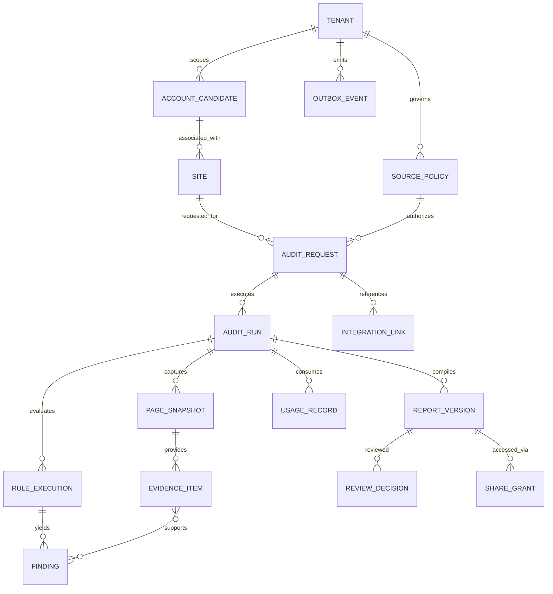

# VRAE 数据架构 V1.1

> 状态：逻辑模型与物理选型建议；未创建数据库、数据表或真实客户资料。2026-11-10。
> 数据所有权：VRAE 管诊断事实与报告；VEYFRONT 管客户咨询与商务；Vey2GE 管增长事件和商机确认；L2M 管交付工件。

## 1. 数据设计目标

1. 所有客观结论追溯到访问许可、页面版本、URL、观察时间、证据哈希和规则版本。
2. 原始观察不可静默改写。误判、修订、复核一律产生新决定或新报告版本。
3. 域名不是企业的法定唯一 ID；相同企业名称不等于同一法人。
4. 诊断申请不代表商业询盘；报告分享不代表客户已阅读，更不代表成交。
5. 真实第三方网站证据默认私有，不向 GitHub、分析服务或公共搜索页暴露。
6. 数据隔离采用 workspace/tenant_id，当前可以只运行一个内部工作空间，但不能依赖全局管理员绕过隔离。

## 2. 数据所有权与权威来源

| 实体数据 | 唯一权威 | 消费者 | 不允许的行为 |
| --- | --- | --- | --- |
| 企业候选/公开站点档案 | VRAE 的候选观察对象；非工商权威 | VEYFRONT/Vey2GE 经核实映射 | 以域名直接断言法人身份 |
| SourcePolicy 与授权证据 | VRAE | Worker/API | 默认为拥有全站授权 |
| 页面快照、Evidence、RuleExecution | VRAE | 经权限限制的内部审阅 | 在外部项目复制私有原始页 |
| Finding、Hypothesis、ReportVersion | VRAE | VEYFRONT 客户展示 | 将草稿当已批准报告 |
| 真实联系人、WeCom、VF 收据 | VEYFRONT | 经许可的商业系统 | 写入 VRAE 抓取证据对象 |
| 经确认 E2/E3 和商机状态 | VEYFRONT 或后续指定的 Vey2GE 经营权威 | VRAE 只引用必要关联状态 | VRAE 自动推导 E3 |
| Rebuild 项目内容与交付成果 | L2M/人工交付主体 | VEYFRONT | 将公开抓取素材视为已获版权授权 |

## 3. 存储层

- **PostgreSQL**：有事务要求的业务对象、身份/权限、状态机、审批、规则版本、费用账本、事件 Outbox 和队列游标。
- **私有对象存储**：准许保存的原始 HTML、DOM 摘要、截图、受控导出报告；对象路径仅作为引用，强制私有读取和有限生命周期。
- **持久队列**：可先采用 PostgreSQL 事务领取与租约；若选择 pgmq 需单独测超时、重放、死信和崩溃恢复。Blob 列表不能代替原子任务队列。
- **运营日志/指标**：记录非 PII 的 job_id、规则版本、状态、费用和错误码；需要授权时才联结原始页面证据。

**物理部署建议**：VRAE 独立 PostgreSQL 项目和独立凭据，绝不直接使用 Vey2GE 现有高权限连接字符串。供应商、区域、保留周期目前未最终选定。

## 4. 逻辑 ERD

ERD 中关联是**逻辑上的**，不表示候选企业关系经过法律主体核验；Evidence↔Finding 使用独立映射表保存一对多证据引用。

## 5. 物理表建议（尚未生成 DDL）

| 数据域 | 表 | 主键/关键字段 | 必须的不变量 |
| --- | --- | --- | --- |
| 身份 | tenants, members, role_grants | tenant_id, actor_id, role, state | 无跨租户访问；权限撤销即生效 |
| 企业 | account_candidates | candidate_id, domain?, name?, jurisdiction?, source_ref | 不能凭同名或同域自动合并法人 |
| 网站 | sites | site_id, canonical_host, source_policy_id?, ownership_status | 观察域名与属主授权分别记录 |
| 许可 | source_policies | policy_id, mode, reference, permitted_hosts, scope, expires_at, revoked_at | 每个任务校验授权版本；撤销后拒绝 |
| 请求 | audit_requests | request_id, tenant_id, site_id, mode, requester_ref?, idempotency_key, state | 事务插入后才向外返回受理 |
| 执行 | audit_runs | run_id, request_id, input_hash, rule_version, prompt_version, status, attempt, deadline | 同一输入重试不可重复计费越限 |
| 网页 | page_snapshots | snapshot_id, run_id, url, final_url, role, fetched_at, object_key, sha256, capture_mode | 对象不可覆写，私有存储引用 |
| 证据 | evidence_items | evidence_id, snapshot_id, locator, excerpt_ref?, certainty, checksum | 缺证据只能标 UNKNOWN |
| 规则 | rule_executions | exec_id, run_id, rule_id, rule_version, applicability, result, error_code | 规则结果是事实层，不允许模型修改 |
| 发现 | findings, finding_evidence | finding_id, run_id, observation, hypothesis?, severity?, scope_fit, evidence_id | 客观发现必须有真实关联证据 |
| 报告 | reports, report_versions | report_id, version, run_id, content_hash, state, approved_version? | 改动即新版本、旧审核失效 |
| 审核 | review_decisions | decision_id, report_version_id, actor_id, action, reason, time | 审批记录追加，不可静默覆盖 |
| 分享 | share_grants | grant_id, report_version_id, expires_at, revoked_at, subject_ref, token_hash | token 只存哈希，有限权限、过期/撤销 |
| 对接 | integration_links, outbox_events | provider, external_id, schema_version, event_id, delivered_at | 不跨系统直接外键；事件幂等 |
| 费用 | usage_records | run_id, provider, model, tokens?, unit_cost?, currency, estimate, reconciled | 费用未知不可当 0；人工成本单列 |
| 任务 | queue_jobs / leases | job_id, run_id, lease_owner, lease_until, attempts | 消费失败可恢复且不超配额 |

### 建议索引与唯一性

- UNIQUE(tenant_id, idempotency_key) 作用于创建任务；**不同 run** 可以复核同站点，但不得由于重放重复扣费。
- UNIQUE(tenant_id, source_system, external_id) 作用于明确外部对象，避免重复商机交接。
- INDEX(tenant_id, state, created_at) 支持待审列表。
- INDEX(run_id, rule_id, rule_version) 与 INDEX(snapshot_id, sha256) 支持重放和溯源。
- Outbox UNIQUE(tenant_id, event_id)，投递至消费者时携带可幂等 external_event_id。

## 6. 数据分级与访问控制

| 等级 | 典型数据 | 权限 |
| --- | --- | --- |
| Public metadata | 域名、公开报告中核准的非敏感摘要 | 按实际公开许可分发 |
| Restricted | 诊断结论草稿、行业配置、任务和成本明细 | 内部 Reviewer/Owner |
| Confidential | 快照、未脱敏截图、授权文档、原始 AI 输出 | 仅授权审核与最小权限 Worker |
| Sensitive PII | 用户联系方式、真实客户询盘 | 仍以 VEYFRONT 线索库为权威；VRAE 只保留必要不透明引用 |

- RLS/服务端 tenant 检查必须双重测试；内部服务也不能省略审计身份。
- 证据存储的真实客户页面截图可能含个人数据，必须自动/人工识别后按最小必要原则保留；分享报告默认去敏。
- 短期分享链接仅映射批准的 report_version，不暴露 source snapshot 或内部存储路径。
- 未经客户同意，不向第三方 LLM 发送完整联系人、询盘、账号或敏感页面内容。

## 7. 数据生命周期与纠错

1. Create：先校验 policy/version/limit 并写入请求，生成唯一 run。
2. Capture：记录采集时间、真实响应、页面角色、内容摘要与 SHA256；原始证据新对象写入、不覆盖。
3. Evaluate：规则输出关联证据，AI 产出假设并受 schema / 引用校验。
4. Review：拒绝/批准/退回为追加事件；批准绑定精确报告内容哈希。
5. Share：生成授权访问，默认到期与可撤销；撤权后立即拒绝。
6. Retain/Delete：到期清理原始对象、处理合法的数据删除请求；保留必要的非敏感审计记录与墓碑事件。不得无限期保留原始站点镜像。

**候选起始值**：公开 HTML/截图证据约 30 天、已授权报告约 90 天，但这不是法律结论或已生效策略；需在试点开始前由运营主体与合法用途审核确定。

## 8. 数据迁移与回滚

- 使用有版本的数据库迁移，先 additive 扩展再弃用旧字段，不进行不可逆的线上隐式迁移。
- 备份与恢复必须在真实 PostgreSQL 的低权限角色中验证，包括租户权限、对象清单和事件幂等。
- 证据关联不能因对象清理而悄悄变成“证据仍可读取”；应明确过期状态与留存的可信哈希。
- VRAE 与 Vey2GE/VEYFRONT 不共享 schema 迁移，不同步删除对方权威数据。

## 9. 最小 API 写入一致性原则

提交：在单一 DB 事务中检查配额并插入 AuditRequest、AuditRun、Outbox/job；事务提交后返回 202。Worker 以 compare-and-swap/租约领取，生成对象后写 DB 引用；失败清理孤儿对象。审批：必须绑定 report_version/content_hash 和授权 Reviewer，若内容已改变就拒绝旧审批。对外事件：Outbox 与本地状态变更同事务写入，消费者负责幂等去重。

详见 [应用架构](SYSTEM_AND_APPLICATION_V1.1.md) 与 [接口契约](INTEGRATION_CONTRACTS_V1.1.md)。
