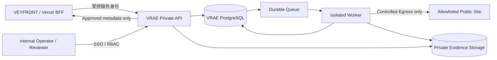

# VRAE 部署、运行与安全架构 V1.1

> 状态：待工程验证的安全设计；没有运行中的 VRAE 服务、数据库或 Worker。2026-11-10。

## 1. 部署拓扑与安全区域

**关键隔离**：不可信网页和 Chromium 位于 Worker 执行域；API/DB 不允许直接执行外网网站脚本，Worker 不持有 VF 联系信息、L2M 生产站或 Vey2GE 的高权限凭据。

## 2. 三种环境

| 环境 | 面向对象 | 资源 | 退出标准 |
| --- | --- | --- | --- |
| local-synthetic | 开发与安全测试 | Docker + 合成网页 Fixture，无生产秘密 | 安全负例通过、结构化规则可重现 |
| private-preview | VEYFRONT 内部审阅 | 私有 API + Worker + 测试 DB/存储，受保护入口 | 真实浏览器/隔离运行/队列恢复/审核流程通过 |
| production-limited | 真实授权试点 | 独立生产 DB、私有对象桶、日志告警和运营值班 | RA-5 业务与安全签署后再开放 |

- 不复用 VEYFRONT 官网的 serverless HTTP 请求执行长任务。
- Worker 必须有持续消费能力；其部署平台和运行位置需依据实际任务强度、商业许可、网络隔离能力与预算确定。
- 现在无需购买香港 VPS；若将来选 VPS，必须有独立网络出站约束、容器用户隔离、备份、滚动升级和复盘，不可把两个普通 Docker 容器视作足够安全。

## 3. URL 接受与 SSRF 防护（硬门禁）

1. 仅允许 http/https，默认仅 80/443，拒绝 userinfo、非标准端口、IP literal、不可解析域名以及危险的路径编码。
2. 先解析 A/AAAA 并验证所有候选地址的公网属性；阻断内网、回环、链路本地、保留网段、metadata 地址、IPv4-mapped IPv6、DNS rebinding 和重定向逃逸。
3. DNS 检查与实际连接的目标 IP 强绑定；不能校验一次后让 HTTP 客户端自行重新解析到另一个地址。每一跳重定向和每个浏览器资源请求执行策略。
4. 对访问范围实行 host allowlist + 站内路径策略；第三方 CDN 等资源只能在独立受控资源政策下允许，不跟踪任意外链。
5. 额外使用网络层 egress 拒绝内部地址；浏览器自身、Service Worker、WebSocket、下载及 JS 发起的请求都应防止绕过请求拦截。
6. 采集系统不被允许执行网站发来的代码指令；网页内容、HTML 注释、Script、图片 ALT 都属于不可信数据。

**测试要求**：覆盖 127.0.0.1、localhost、RFC1918、link-local、169.254.169.254、IPv6、DNS 重绑定、URL 重定向链、编码混淆和外部 CDN 子请求。未通过测试绝不开放匿名 URL 检查。

## 4. 礼貌抓取与授权

- 内部公开站研究：仅检查经审核的公开页面与来源使用条件，尊重 robots/访问条款与禁止采集声明；允许站点申请停止。
- 客户深度诊断：需要单独的属主或被授权代理人的有效授权，限制域名、数据范围、用途和有效期。
- 不绕过登录、验证码、WAF、访问限制；不使用代理轮换突破封锁。
- GET/HEAD 只读网络流量；禁止真实表单 POST、修改、上传、购买、站点后台操作、未经授权的性能压力或安全扫描。
- 单域同时一个任务，按站限速和超时；访问失败是 ACCESS_BLOCKED/UNKNOWN，不能当作网站质量缺陷。
- 浏览器测试是 UX 观察而非完整渗透测试或正式 WCAG 认证。

## 5. 执行预算与计费策略

| 指标 | L0 初筛 | L1 初评 | 深诊 |
| --- | --- | --- | --- |
| 目标 HTML 页 | 建议 3–5 | 建议不超过 8 | 必须另行授权 |
| 单页 HTML 大小 | 候选 1.5 MB | 候选 1.5 MB | 另定 |
| Playwright | 默认无 | 2–3 代表页，桌面+手机 | 另定 |
| LLM | 不调用 | 一轮 + 最多一轮有界修复 | 另定 |
| LLM 费用 | 0 | 建议上限 ¥2/站 | 单独审批 |
| 外发 | 禁止 | 必须人工批准 | 必须人工批准 |

这些是**提议中的门禁参数**，不是实测费用、已经开通的限额或 SLA。要分别记录 token、模型供应商、计算、存储、人工审核和业务触达成本。未知账单不能按 0 元处理；预算不确定时停止新增付费调用。

## 6. Worker 隔离

- 非 root、只读根文件系统、短期临时卷、CPU/内存/运行时限、进程数和文件大小限制。
- 单任务临时目录，任务结束清理；浏览器容器无法读取全局环境秘密和持久化 DB 管理员密钥。
- 存储权限按 prefix、job 和操作限制；不能列举任意客户或其他租户证据。
- 禁止执行外部 HTML 内嵌的 shell 命令、从远站安装包或引导本地执行。
- Browser 只使用必要 Chromium/Playwright 组件；安全补丁版本固定，镜像可追溯。
- 一次运行需要留下最小追踪：run_id、策略版本、代码 SHA、输入哈希、资源消耗和错误代码。

## 7. 身份、权限和密钥

Owner/Reviewer/Operator、内部服务身份与 Worker 权限分离；每一项写操作都要服务端校验身份、租户与目标对象版本。生产和 Preview 密钥分开，支持轮换和撤销。API 服务不得将数据库超管口令交给 Worker。日志中不得打印 Authorization、Cookie、客户联系方式、完整 HTML 和敏感证据。

## 8. 数据保护

- 原始截图可能包含他人个人资料、商业秘密或受版权保护的内容：默认私有、最低必要收集，分享前脱敏。
- 网站公开可访问不等于允许商业公开转载图片/证书/案例。
- 对外报告只展示经审核的必要截图/片段、来源时间和限制说明；分享令牌只存哈希、有期限且可撤销，页面禁止索引。
- 法定运营主体、适用隐私告知、跨境传输和数据保留策略在正式试点之前需要合法性确认。
- 客户撤销授权立即停止后续抓取；对现存数据依法处理并保留非敏感审计痕迹。

## 9. 运行可靠性与灾难恢复

- 数据库迁移具备回滚计划与恢复演练；队列重试要限制 attempts、记录上一次错误并最终 dead-letter。
- 应对 API 崩溃、Worker SIGKILL、超时、对象存储部分失败、模型超预算、供应商故障、回调重放和任务取消。
- DB 写入与消息 Outbox 同事务，保证状态变更不会无事件；存储对象写入后 DB 失败要可清理孤儿文件。
- 运营指标：准入阻断率、抓取可用率、规则误报、浏览器成本、AI schema 拒绝率、人工审阅时间、任务死信和费用异常。
- 新部署只能先内部预览验收，客户可见和公开诊断须另外审批。

## 10. 禁止误报的运行状态

把 HTTP 抓取成功称为 FETCHED，而不是 AUDIT_SUCCESS；Playwright 无法启动标 BROWSER_NOT_RUN；模型 schema 拒绝标 AI_INVALID；报告未审核为 REVIEW_REQUIRED；客户尚未回应不能标 E2/E3。

与 [RA 路线图](../03-engineering/ROADMAP_AND_ACCEPTANCE_V1.1.md) 联合执行。
