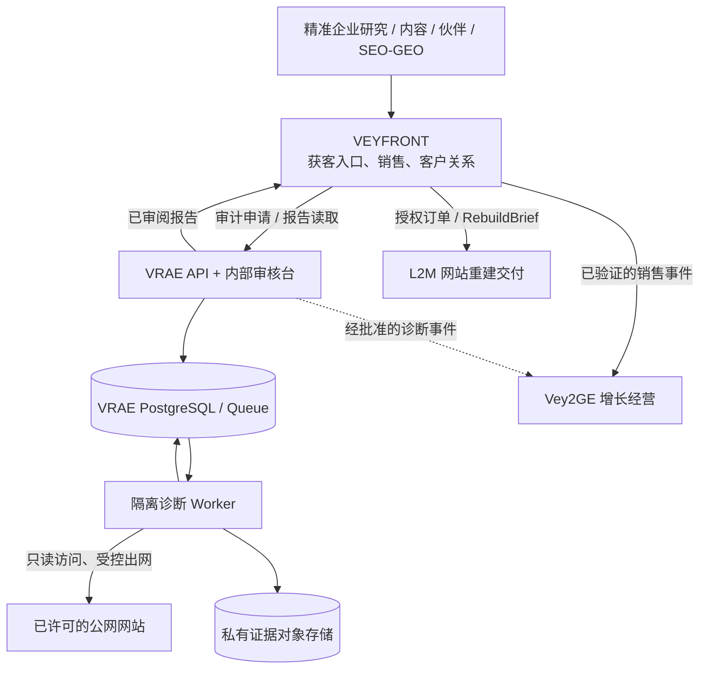
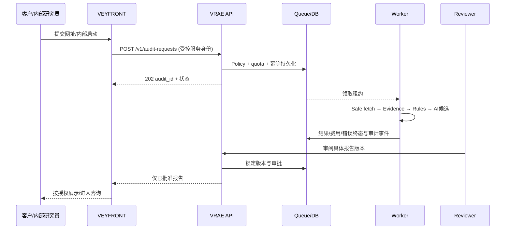

# VRAE 总体系统与应用架构 V1.1

> 状态：目标架构，不表示已经部署。2026-11-10。
> 决策：独立 VRAE 仓库；模块化单体；API 与 Worker 双进程；独立数据与权限；跨产品 API / 事件集成。

## 1. 系统上下文

- VEYFRONT 是客户体验和商务主体；只转发经鉴权的申请/已审阅报告，不执行长时间采集。
- VRAE 只拥有诊断任务、采集证据、规则执行、审核和报告。
- Vey2GE 后期才消费经许可的事件，不作为 VRAE 的运行依赖。
- L2M 后期经客户授权接受 RebuildBrief；不运行在诊断主链路内。
- **禁止**直接跨系统访问彼此数据库或复制联系人明文。

## 2. 模块化单体，不等于单进程

| 容器/模块 | 职责 | 权限和边界 |
| --- | --- | --- |
| API（候选 FastAPI） | 身份、SourcePolicy、配额、创建任务、查询/审核/报告/分享授权 | 不接触任意外网采集，不执行 Chromium |
| Operator Console | 任务池、证据比对、报告审阅、审批、成本查询 | 受保护的 VEYFRONT 内部工作区；无公开注册 |
| Orchestrator | 状态机、队列、租约、去重、失败/重试/取消 | 通过 PostgreSQL 事务访问任务；幂等 |
| Worker | 有界 Fetch、DOM/浏览器观察、证据提取、规则、可选模型调用 | 单任务隔离、严格 egress、资源配额、无生产官网密钥 |
| Rules & Domain | 诊断规则、证据/假设区分、行业包、版本 | 纯业务逻辑，可离线测试 |
| Report Service | 汇总已核实发现、批准报告、受控分享、审计记录 | 未审批不得客户可见 |
| Integration Adapters | VF API、Vey2GE 事件、L2M Brief | 版本化合同、签名/鉴权、失败可重试 |

API 和 Worker 共享同一发布版本的 Python 领域库，但使用不同凭据、容器权限和部署生命周期。仅仅是两个 Docker 容器不代表隔离安全通过，必须做网络与权限验收。

## 3. 代码分层

- Domain：Site/Policy/Audit/Observation/Finding/Report/Review 等不可变业务约束；不依赖数据库或 HTTP 框架。
- Application：SubmitAudit、RunAudit、ApproveReport、IssueShareGrant、SalesHandoff 等用例与状态转移。
- Infrastructure：PostgreSQL repository、对象存储、事务 Outbox、模型供应商、HTTP/Playwright 采集。
- Interface：REST API、Operator UI、事件消费者/发送器及外部 VF Adapter。
- IndustryPack：结构化的行业适用规则、术语、证据需求；核心表与 API 不写死阀门/机械行业专属字段。

**依赖方向**：Interfaces → Application → Domain；Infrastructure 实现 Domain/Application 声明的 Port。外部系统不能绕过服务层读取私有证据。

## 4. 诊断同步/异步流程

**状态建议**：
CREATED → POLICY_CHECK → QUEUED → FETCHING → EVIDENCE_READY → RULED → DRAFT_READY → REVIEW_REQUIRED → APPROVED → SHARE_GRANTED → ARCHIVED。

独立失败终态：POLICY_BLOCKED、ACCESS_BLOCKED、INSUFFICIENT_EVIDENCE、MODEL_INVALID、REVIEW_REJECTED、FAILED、CANCELLED。拒绝/不可访问/证据不足不得被记作成功报告。

业务分享状态与运行状态分离；审核批准不等于已发送，已分享不等于产生 E2 询盘，更不等于 E3 商机。

## 5. 降级和弹性

- 采集失败：记录已访问 URL、访问失败分类和范围；不绕过访问限制继续爬。
- 浏览器失败：有确定性证据则标注覆盖范围，不能假称真实浏览器验证完成。
- AI 失败：结构化规则/证据仍可供人工评审；不可生成无依据的对外结论。
- DB/Queue 故障：申请失败返回可观察错误；禁止仅返回“处理中”但任务未落库。
- Vey2GE 和 L2M 故障：不影响 VRAE 诊断；待对接时通过 Outbox 失败重试。
- Worker 中途退出：租约超时 + 重取，必须检查输入哈希、版本、任务配额和幂等写入。
- 老报告不会被新采集静默覆写。

## 6. 环境和部署演进

- 初期：Docker Compose/合成样本，单 Worker、无公网入口、无需购买新服务器。
- 内部试点：独立受保护 API、一个受限 Worker、托管 PostgreSQL/持久队列、私有存储；默认并发 1。
- 公网自助：另行通过身份、反滥用、费用、隐私、运营值班及合法数据授权门禁，默认不开放。

技术候选：Python + FastAPI/Pydantic、Playwright、PostgreSQL、私有对象存储；队列可采用 Postgres 事务领取、pgmq 或其他明确受支持的持久方案，最终选型需容量与故障回归。

详见 [数据架构](DATA_ARCHITECTURE_V1.1.md)、[接口](INTEGRATION_CONTRACTS_V1.1.md)、[安全部署](DEPLOYMENT_AND_SECURITY_V1.1.md)。
