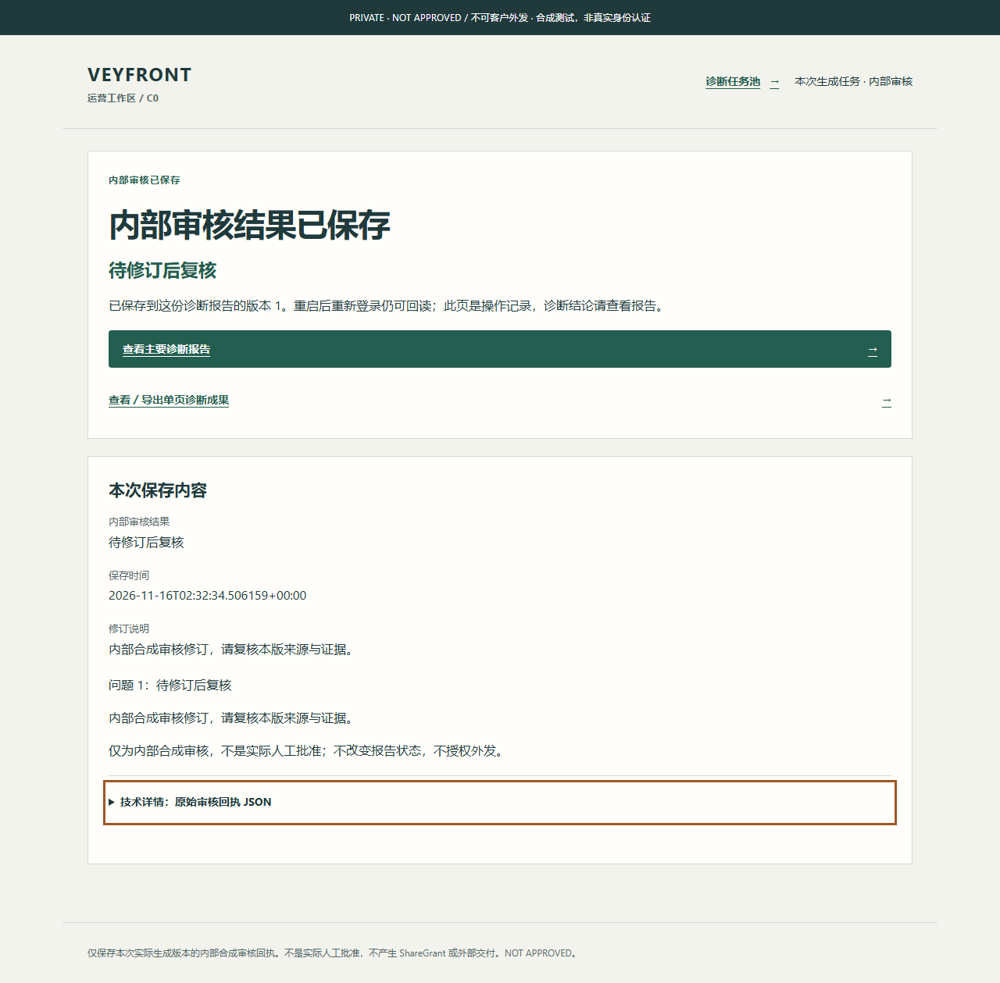
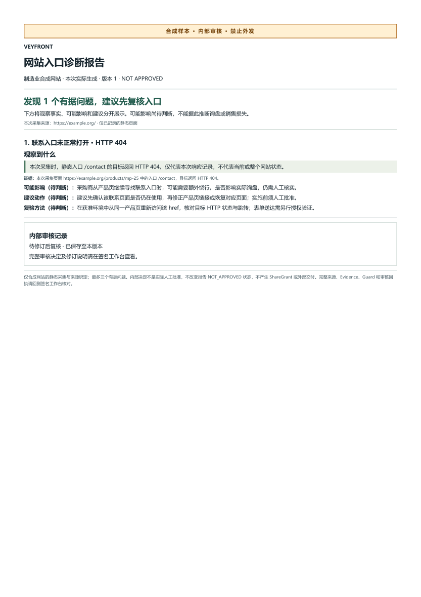

# L1 诊断体验：先看诊断成果，再看操作记录

原来审核提交成功后首先看到大段回执 JSON，容易把操作记录误当成诊断报告。本次只调整现有签名 SSR 的呈现：先回答“发现了什么、凭什么判断、可能影响什么、建议怎么做、如何复核”。

报告默认显示中文摘要和来源。404 的入口响应记录形成有据问题；200 明确显示“0 个有据问题／证据不足”，不能据此判断网站健康、表单送达或询盘成功。影响与建议仍明确待判断，原始事实文本、Evidence、Guard、UUID 和哈希保留在可展开技术详情中。

审核后首先显示“内部审核结果已保存”、内部决定和说明，并突出“查看主要诊断报告”。回执继续只是操作记录。A4 以诊断成果为主体；屏幕上可展开原始绑定，打印时不带操作栏、技术 JSON 或 UUID 大段内容。

从报告直接打开 A4 时只说明“本页未附审核记录”，不推断系统没有保存回执。下方打印对比展示的是从具体已保存审核记录打开的 A4。

事实原件、报告版本与哈希、来源、签名授权、审核校验及持久化逻辑不变。内部合成审核仍不是实际人工批准或外部交付。未增加另一套工作台或改变 V1.1 战略。

## 实际页面前后对比

以下来自真实 APP 提交、原 Worker 和签名读取后的 Chrome 页面。改动前产品文件来自已验收 main `3233e7b69b5cf4e76ca5c52e393aa592dd365d9e`。前后分别运行同一合成分支的新任务，因此任务标识和采集时间不同，不把旧报告当成新结果。

| 404 分支 | 改动前 | 改动后 |
|---|---|---|
| 诊断报告 | [查看原页面](before/report-404.png) | [查看新页面](after/report-404.png) |
| 审核提交结果 | [回执 JSON 为主](before/receipt-404.png) | [保存成功及主要报告入口](after/receipt-404.png) |
| 实际 A4 打印 | [打印图](before/a4-404.png) · [PDF](before/a4-404.pdf) | [打印图](after/a4-404.png) · [PDF](after/a4-404.pdf) |

| 200 分支 | 改动前 | 改动后 |
|---|---|---|
| 诊断报告 | [查看原页面](before/report-200.png) | [查看新页面](after/report-200.png) |
| 审核提交结果 | [回执 JSON 为主](before/receipt-200.png) | [保存成功及主要报告入口](after/receipt-200.png) |
| 实际 A4 打印 | [打印图](before/a4-200.png) · [PDF](before/a4-200.pdf) | [打印图](after/a4-200.png) · [PDF](after/a4-200.pdf) |

## 如何体验

继续使用已验收 M3 启动器中的同一个签名工作台。提交合成来源、等待生成、签名打开报告。先读摘要和问题，再展开需要核对的技术详情；保存内部审核后，通过主要报告入口回到诊断成果，或打开 A4 使用浏览器打印／保存 PDF（纸张 A4）。无需新部署或配置新的工作台。

自测复用现有真实 PG/浏览器路径，检查 404/200、桌面及 375/320 窄屏、技术详情的默认收起与展开、保存后的报告回跳、原始版本/哈希核对、实际单页打印和重启回读。页面与 PDF 文件的来源及摘要见 [comparison.json](comparison.json)。完整 CI 结果由 Draft PR 的最终说明提供。
