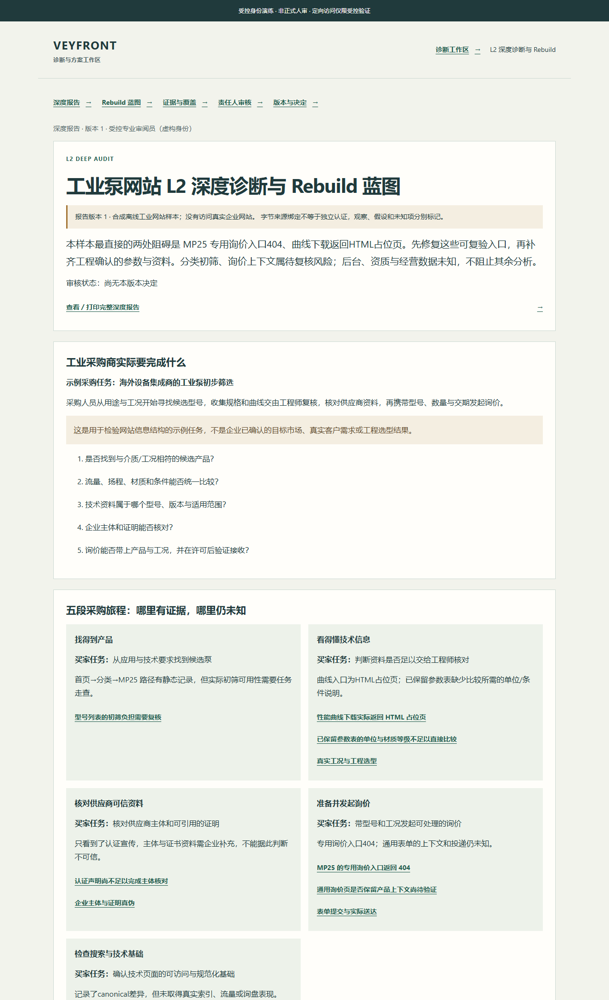

# L2 深度诊断与 Rebuild 改造蓝图

先看实物：[工业网站深度报告 PDF](sample/l2-deep-report.pdf)（12 页）、[改造蓝图 PDF](sample/l2-rebuild-blueprint.pdf)（6 页）。也可直接阅读[报告正文](sample/l2-deep-report.md)和[蓝图正文](sample/l2-rebuild-blueprint.md)。这是一份来源绑定的离线合成工业泵网站诊断，不是已交付的真实客户报告。

## 它回答什么经营问题

海外采购人员从找到产品、判断参数和工况、核查供应商，到发起询价，需要哪些信息？报告沿五个采购环节分析，逐项区分已观察事实、待复核影响和未知事项。

例如，MP25 产品询价入口对应保留响应为 404；名为曲线 PDF 的链接返回 200，但正文实际是 HTML 占位。这两项可以形成优先修复讨论。参数表中的流量、扬程缺单位和条件，只能说明这张保留表格的信息不足，不能声称全站没有资料。ISO9001 宣传文字不能替代资质核验；通用询价表的静态字段也不能证明后台没有携带型号。产品工程适配、邮件送达、真实认证和经营成效仍为 UNKNOWN，不能排列成缺陷或编造损失。

7 份保留页面、10 处精确字节引用，支撑 11 项观察、假设或未知。每项提供证据、影响边界、优先级理由和复核方法；并非 11 个已证实故障。所有网站地址均为合成材料，无网络抓取或表单发送。

蓝图把有据发现转为六个工作包：询价与型号上下文、参数/曲线模板、目录与应用导航、资质信息、canonical 与有限迁移、可选定制集成。每项说明修改页面、采购影响、企业需确认的资料、责任角色、先后依赖及验收动作。前五项是标准服务候选，须按合同确认；配置器、PIM/ERP/CRM、多站及大规模迁移属于定制评估。没有编造 VEYFRONT 已批准服务清单、报价、工期或工程选型结论。本蓝图不是客户授权的 RebuildBrief，也不是已开始的改造交付。

## 实际界面与审核



[蓝图界面](sample/rebuild-blueprint-overview.png) · [证据查看](sample/source-evidence.png) · [可操作审核表](sample/review-operable.png) · [保存后结果](sample/review-saved-not-formal.png) · [版本历史](sample/versioned-decisions.png) · [定向访问管理](sample/directed-access-management.png)

在已有 B5B Application 中挂载 `/b5a/l2/`，复用原 HTTP 服务、安全边界和页面框架。已配置 M2 时在同一工作台互相导航，未创建第二套工作台或伪造 M1 分配。

审核人逐项核对 11 项诊断与 6 项改造建议，选择确认、拒绝或要求修改，填写决定理由并确认审阅范围。提交同时绑定租户、来源、报告版本、原生内容哈希和完整展示哈希。建议修订追加新版本，旧决定保留；错版本提交返回冲突。回执展示签名目录中的责任人、时间、原因及版本，不能自己填写姓名冒充审核人。离线 SQLite 持久保存，实际重启后可回读。

演示使用虚构身份和独立受控签名，所有回执明确 `CONTROLLED_REVIEW_SIMULATION`，**正式真人审核数为零**。真实责任人分支要求外部核验目录、可核查主体引用、固定发行者/JWKS、`VERIFIED_PERSON_MFA` 及现行报告权限；旧 TEST_ONLY 登录令牌不能晋升。该分支只验证了协议约束，尚无真实企业 IdP/责任人接入证据，不能声称已正式人审。

受控定向访问要求指定接收人签名身份和单独秘密，数据库只存秘密哈希。换人、撤销、过期、决定改变或报告换版均拒绝；秘密不进入 URL。每次阅读重验权限。**未向真实外部客户分享，正式外部分享路径未启用。**

## Owner 本地操作

在仓库根目录，使用已安装项目锁定依赖的 Python、Node 和 Chrome：

```powershell
python -B -m integration.l2.lab owner-review-unique-label --interactive
```

使用每次不同的标签。命令打开专用的受控 Owner 浏览器，可看报告、蓝图、证据、逐项审核、保存、修订与打印。Ctrl+C 结束专用进程。该入口不是正式 Owner 身份；浏览器及 SSR 均不持有签名私钥。私钥只在启动器父进程内，服务子进程接收公开验签目录。

已有真实工作台的私有启动配置可以传 `deep`，或原 `integration.b5b.http_server` 使用 `--deep-profile`。结构及 Codex1 对接见 [CONSUMER.md](CONSUMER.md)。不在仓库提交私有目录、令牌、数据库或密钥。

## 验证证据与边界

[本地原始发布清单](sample/publication.json)包含 26 项真实浏览器检查、12 张页面截图、实际进程重启、两份 Chromium PDF 及 SHA256。覆盖错版本、越权、接收人不符、撤销后再读、换版使旧访问失效、重启回读、中文打印和移动布局。PDF 是完整自然分页的 L2 成果，未压缩成 L1 一页。

样例清单对应本地 15 项原生检查，另增加两项实际 Codex1 契约数据检查；最终托管 CI 在本 PR 精确提交上运行完整 17 项及浏览器。样例 `run.json` 保留当时基线 HEAD 和工作文件 SHA，不冒称提交后 CI。原始失败保留于私有 `.runtime`，包含早期测试工具问题和沙箱 Chrome 超时；针对原因修复后取得当前结果，不改写 RED 为 PASS。

本轮使用明确离线来源、独立离线审核库，没有伪造 Worker/APP202 任务或 PG 验收。Codex1 原生深度结果的消费契约已校验，但接入已验收生产者的完整源/Guard 重放仍是后续集成边界。旧 SQL、RLS、Guard、认证 TTL 和原审核持久化逻辑未改变。Owner 尚未验收本候选，不自行合并或部署。
