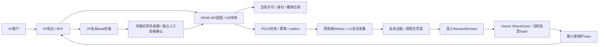

# 运行、数据、成本及R1 exact-source计划（提案）

R0只验证合同和临时SQLite fixture，没有真实API、Worker、PG、网站、浏览器任务、模型或部署。以下资源/适配器由Owner G0后分工实现；不选择云厂商、区域、资费或上线时间。

## 提议的数据面与控制面

VF拥有客户联系资料/联系同意与咨询事实；VRAE只持最小opaque关联、报告授权与收据确认。浏览器不会持服务key、原始证据或模型原文。VF existing lead API保持原主权，不能建立第二CRM镜像。

VRAE发布视图前须解析当前SourcePolicy、原报告最新版本、真实人审、Owner grant/view hash、recipient token和撤销。前台、反向代理、下载及对象存储缓存都服从撤销；默认private/no-store，无永久可公开对象URL。匿名公开另需Owner决定，当前禁止。

R1真实任务提交要求事务性tenant/idempotency/body绑定与outbox；202后队列故障允许恢复同一run，不造新任务。Worker重复投递去重，取消有线性化边界，撤回后不得提交新可读结果。权限失效优先于缓存/历史签名。原30秒Worker lease和既有Guard/SourceAccess/PinnedTransport/RLS不放宽。

SQLite fixture展示本地commit、重开连接、幂等和撤销。它不证明PG并发、跨系统原子事务或生产恢复；这些需要Codex3 R1持久适配及原始PG证据。跨系统不存在“邮件和两库一起提交”的假原子性：VF先真实保存，receipt丢失时WAITING_ACK并对账，同意图取同一存储receipt。

## 四本成本账与预算

| 提议操作分账 | R0现状 | R1必要量 |
| --- | --- | --- |
| collection | UNKNOWN / amount=null | DNS/HTTP次数、字节、页面、运行时间，原预算拒绝 |
| browser | UNKNOWN / amount=null | 启动次数、时长、子资源、失败/中止成本 |
| model | UNKNOWN / amount=null；NO_MODEL | 独立purpose/地区/Provider GO、tokens/units、失败和未知费用断路器 |
| human_and_commercial | UNKNOWN / amount=null | 人审与商务实际工时/事件；不能用点击或邮件计量成交 |

这是一份待Owner确认的跨仓操作视图，不替换原S4账簿/成本算法。MEASURED / ESTIMATED / UNKNOWN / UNRECONCILED必须区分；未知费用不能填0。预算、并发、单域限额由受信策略存储提供，前台数字不授予权限。未定量的成本触发UNKNOWN或拒绝，不能绕过既有预算门禁。

## 威胁与本轮可证伪边界

| 风险 | R0证据/拒绝 | R1 exact-source验收 |
| --- | --- | --- |
| checkbox冒充站点控制/许可 | 缺失/撤销/过期/错tenant/错scope/坏签名均拒绝 | 真实许可发行和撤销解析；只读快照不能覆盖实时撤销 |
| 幂等key复用不同请求或错audit | body hash/tenant/id冲突409；重开journal同run | PG并发双提交、commit响应丢失、outbox恢复、故障注入 |
| 202误称诊断完成/队列失败假成功 | CREATED/PENDING_DISPATCH、diagnosis_complete=false；存储503 | 队列断开/重连/重复投递，实测阶段与稳定任务引用 |
| 新假状态/假百分比 | 原14状态逐项映射；COMPLETE拒绝；percent=null | 查询基于真实producer而非静态前端模拟 |
| L1许可冒充L2采集桥接 | 原L2创建不可用；只做L2消费样例 | Codex1桥接OWNER_AUTHORIZED_DEEP、角色/路径/robots/预算 |
| SSRF、DNS rebinding、redirect/子资源逃逸 | R0没有网络实现，测试拦截socket/DNS；原canonical_url不放宽 | 原resolver/public_addresses/PinnedTransport/SafeFetcher；模拟DNS/loopback隔离负例及内核出网拒绝，不触碰真实域名 |
| API客户端伪造role、真人、current_version | schema不接收这些授权字段；签名测试端口来自外部registry | 真实身份绑定、kid轮换/撤销、issuer/audience/exp、真实人审归属，禁止客户端提供授权bool |
| DRAFT/REVIEW_REQUIRED/旧版或他人token下载 | 原check_share、token hash/subject/audience、Owner view hash/current grant、源许可复验 | 版本修订与撤销的并发下载；缓存/CDN/旧对象URL均不能旁路 |
| 私有原文/PII进入默认public view | 字段白名单、短引用、签名投影hash及deny scan负例 | 正式人工脱敏/权利审核；pattern不是通用PII检测器 |
| 假VF ACK、重放、错版本/请求/tenant | 独立存储fixture后签名；假ok/坏key/修改event拒绝；准确重放幂等 | VF真实存储readback、签名adapter、回调认证、落库后断网对账 |
| 自动服务冒充商业人员 | VF service签qualification拒绝；独立Owner认可人身份fixture | 真人独立确认/撤销，真E2/E3定义仍Owner裁决 |
| 取消后迟到回执复活授权 | 撤回后原读取/ACK拒绝；终态Run不造非法转换 | cancel与job commit/receipt并发；删除与撤回独立持久回执 |
| 升级原SyntheticIntake为真实CRM | 不导入/修改；其_rows重启丢失，原PG Brief独立 | 单独真实receipt仓库与R1恢复测试，不迁移假ACK为商业事实 |

## R1交接检查点

每项必须记真实源SHA、运行环境、实际组件、首次CI终态及原件hash；合成身份/数据和正式身份/数据分开。SourcePolicy/Guard/EvidencePack/RLS/Worker租约任何实质差分单独呈Owner，不在本PR修改。R0仅准备接口及负例，不把本地SQLite PASS写成PG/Worker/Chrome或生产安全PASS。

Codex1负责合法安全采集适配；Codex3负责私有运行/PG/outbox/恢复、观测和部署准备；VF Agent负责前台/BFF及原线索存储后的真实收据适配。Owner统一冻结接口和真实权限。禁止触碰#145 UAT的进程/端口/容器/数据，不prune、不重启；本PR测试只用自己的临时目录。

在选择云/区域/Provider前，先冻结数据最小化、地区、保留与删除、密钥托管、告警/审计、备份恢复、kill switch和回滚的约束。R0/R1不产生计费资源、域名、公网暴露或生产发布。真实网站、客户数据、正式人审、真实ShareGrant、Provider、邮件及云资源分别等Owner单独GO。
