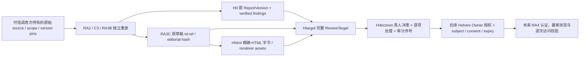
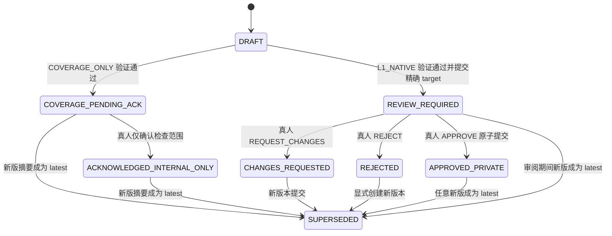

# 人工审核合同候选 P0.1

**设计提案；没有新增已生效 schema、API、数据库或审批事件。** `D_*` 为本设计内部拒绝原因，
不是对冻结 ErrorCode 枚举的添加。下列 MUST 是后续实现验收要求。

## 1. 权威与角色

身份来自未来已验证的会话/认证提供者和服务端租户、任务授权，不来自请求正文、报告
`created_by`、User-Agent、公司自述、模型输出或“我是 Owner”的自由文本。
`actor_id` 对应自然人的可审计主体；有效登录不等于拥有指定任务审核权。

| 动作 | Operator | Reviewer（真实人） | Owner（真实人） | Worker / Service / 模型 | 外部主体 |
| --- | --- | --- | --- | --- | --- |
| 查看分配范围内私有草稿/原始证据 | 允许 | 允许 | 允许 | 无审核工作台权限；既有 Worker 采集证据权限保留原范围 | 拒绝 |
| 提交待审、提出修改稿 | 允许 | 可提出修改意见 | 可提出修改意见 | 仅有界生成候选，不能签署 | 拒绝 |
| APPROVE / REQUEST_CHANGES / REJECT | 拒绝 | 任务级授权且本次明确操作 | 按现有 review 权限明确操作 | 全部拒绝 | 拒绝 |
| 确认零问题检查范围 | 可阅读，不能作 Reviewer 确认 | 允许内部确认 | 允许内部确认 | 拒绝 | 拒绝 |
| 后续发放/撤销分享授权 | 拒绝 | 拒绝 | 独立 share/revoke_share 权限与动作 | 不得假扮 Owner | 拒绝 |
| 客户读取或发出报告 | 本阶段全部禁止 | 本阶段全部禁止 | 本阶段全部禁止 | 本阶段全部禁止 | 本阶段全部禁止 |

沿用 `access.py` 的 OWNER 可 review、只有 OWNER 可 share/revoke；不改变原角色集合。
V1.1 允许同一自然人兼任角色，但必须分别执行审核和 Owner 授权，记录各自动作；
角色兼任、账号所有权或创建报告都不能自动产生批准。是否启用更严格双人复核由未来 Owner 策略另定，不能在客户端关闭。

## 2. 原合同的硬边界

| 已验收组件 | 原语义 | 外层必须补充的约束 |
| --- | --- | --- |
| `report_content_hash` | 原报告清单（不含 status/approved 字段）+ 按顺序解析的 finding；非空 finding | 不是全文、HTML、身份或语义证明；另绑定全文与来源 |
| `approve_version` | 同租户 review 角色、原 hash、版本、decision actor/action/归属一致，返回 APPROVED 副本 | 不认证真人、不校验全文、不持久化、不处理并发；必须在可信应用门禁与事务内调用 |
| `check_share` | Owner share 操作角色、L1/L2、最新版本、原批准归属、hash、grant 时间/状态 | 没有完整 HTML/主体登录/token 实值比对/同意验证；单独调用不构成客户访问授权 |
| `ReviewDecision` | APPROVE / REQUEST_CHANGES / REJECT，只有 native content_hash | `additionalProperties=false`；不能塞入 HTML hash 或冒用 reason 存隐藏权威 |
| `ReportVersion` | 无 REQUEST_CHANGES 状态；APPROVED 需非空 finding | 退回状态放应用投影；零问题不可强造正式批准 |
| `ShareGrant` | 版本、native hash、subject_ref、token_hash、ACTIVE/REVOKED、有效期 | 无 issued_by/全文绑定；未来另存 Owner 授权侧车，不改冻结 schema |

原 `/v1/.../review-decisions` 的 body 是原 ReviewDecision，当前 OpenAPI 没有新审核侧车。
本提案是**未来应用命令与存储契约**，不声称原端点已经接受新字段/If-Match。
未来传输层须独立版本化评审；不扩展原 JSON 对象、不把新字段偷放 reason。

## 3. 完整摘要图与确定序列化



`C(x)` 定义：受限、无重复键的 JSON；key 排序、无空白、UTF-8、保留 Unicode、禁止 NaN/Infinity；
字段类型严格，bool 不当 int；数组顺序有意义。整数和字符串按合同原值，不作 Unicode/换行/URL 等价化。
HTML 使用原始字节 SHA-256，禁止解析后重排、重新渲染、修改 CSS 或加追踪脚本来冒充相同内容。
每个新侧车摘要使用域前缀：`SHA256(UTF8("vrae.ra3d.<kind>.p0.1\n") || C(payload))`，
payload 不含其自身 digest。它们是设计域，非现有生产版本。

`H0` 完全沿用原函数；`rd-ref / editorial / Hhtml` 完全沿用实际被验收 RA3C 版本；
不重定义其算法。SHA 证明内容一致，不证明事件来自真人，后者依赖可信身份及受保护持久记录。

## 4. 候选数据合同（字段均必需；未声明额外字段拒绝）

### ReviewTarget / P0.1

| 字段 | 类型与取值来源 |
| --- | --- |
| contract_version, kind | 固定 `ra3d-review-target-p0.1`；`L1_NATIVE` 或 `COVERAGE_ONLY` |
| tenant_id, report_id, report_version, run_id, policy_id, policy_version | 严格来自可信仓库中经重放的 scope/metadata；版本为正整数 |
| policy_snapshot_sha256 | 可信仓库持有的该策略版本完整规范化摘要；提交前仍单独检查当前授权/撤销，不把旧快照当永久权限 |
| native_report_version_id, native_content_hash | L1_NATIVE 为原版本 id / H0；COVERAGE_ONLY 二者均 null |
| draft_ref, editorial_content_sha256, html_sha256, renderer_asset_sha256 | 原 RA3C 全文、输出与布局绑定；每个 hash 为完整小写 64 hex |
| evidence_pack_ref, execution_ref, finding_package_ref, ordered_guard_refs | 独立调用方持有的真实 pin；逐条 binding/citation 仍由 draft/guard 完整清单绑定，不能仅看全局 refs |
| source_manifest_sha256, guard_inputs_sha256 | 前者为 `SHA256(C({pack_ref,document,objects}))`，document 为完整已验证 pack.document，objects 为按 object_key 排序的 `{object_key,content_sha256,length_bytes}` 列表（后两值由原始字节计算）；后者沿用 RA3C 原 Guard 输入摘要。引用/定位/quote 仍需逐条 Guard 重放；不是 URL 当前真实性 |
| builder_version, evaluator_version, guard_version, reporting_version, editorial_version, renderer_version | 必须与实际重放引擎版本一致，不从模型抄写 |
| model_provenance | 与 ordered_guard_refs 同序的 `{guard_ref,mode,model_id,gateway_version,prompt_version,interpretation_sha256,limitation}[]`；未运行值用显式 null/NOT_RUN，不猜模型或 prompt 版本 |
| artifact_ref | 可信、租户隔离、不可覆盖的对象引用；不能是任意 URL、用户可改文件路径或外部 fetch 指令 |

`target_digest = Htarget`，单独存于受保护仓库并与对象 refs 一起交给审核会话。
显示用截短 hash 不能用于比对。source/Guard pin 不能仅从上传草稿自证获取。
固定 RA3C 候选没有 gateway/prompt 版本字段：参考映射必须标记 NOT_RECORDED，不伪造来源。
未来有真实模型运行而缺少必需 provenance 时阻断正式审核；未运行模型的规则报告可明确记 NOT_RUN。
本轮固定合成样本只用于设计，不具备实际人审/分享资格。

### ReviewSession / P0.1（服务端生成的临时审核上下文）

`session_id`（不透明）、`tenant_id`、`human_actor_ref`、`auth_context_ref`、`assignment_ref`、
`target_digest`、`expected_latest_version`、`expected_review_seq`、`opened_at`、`expires_at`、
`evidence_checks[]`（binding_ref + quote byte range + target digest + opened acknowledgement）。
服务端重新校验权限/角色/任务分配和认证时效；页面勾选不证明真人理解，也不能替代身份验证。
预览展示的是对象库中这份精确 HTML；查看期间当前版本变化必须使会话失效。

### FullReviewDecision / P0.1（与原 ReviewDecision 原子共存的侧车）

`tenant_id`、`report_id`、`report_version_id`、`report_version`、
`decision_id`（服务端分配，租户唯一）、`native_decision_id`、`target_digest`、
`native_content_hash`、`action`、`reviewer_id`、`auth_context_ref`、`assignment_ref`、
`review_session_ref`、`per_claim_dispositions[]`、`reason`、`decided_at`（服务端 UTC）、
`reviewed_sections[]`、`review_seq`、`previous_event_digest`、`idempotency_command_digest`、`decision_digest`。

action 仅 APPROVE / REQUEST_CHANGES / REJECT。逐项处理必须覆盖全部展示的绑定 claim 和正向原文，
key 为 `{guard_ref,binding_ref,pointer}`，不得遗漏/重复/伪造；处理枚举
`ACK_LITERAL_FACT / ACCEPT_AS_HYPOTHESIS / ACCEPT_AS_PROPOSED_ACTION / CHANGE_REQUESTED / REJECTED`。
只有相应机器类型可使用对应处理；全部适当处理完毕才可整份 APPROVE。
退回/拒绝须 1–2000 字理由和具体定位；禁止在客户端任意 reason 中注入可执行内容。
`reviewed_sections` 单独覆盖 coverage / limitations / full_preview / business_boundaries：
每项为版本化 section_id + target_digest + acknowledged，不为没有 Guard 的固定限制文字伪造 binding。
APPROVE 要求完整匹配实际渲染清单，无遗漏/额外/重复 section；这些正文已由全文摘要覆盖。
native_decision_id 必须等于 decision_id，二者为同一决定的一对一记录；原生 decision 与侧车的
tenant、版本 id/数字、H0、action、reviewer、reason、decided_at 必须一致，且与 target/认证上下文一致。
不接受“原生批准 A、侧车却绑定 B”的组合。

原 RA3B `HUMAN_REVIEW_REQUIRED`、`REJECTED` 和原字面事实状态**不改写**。
真人接受一种假设表达只增加侧车处理，不升级它为已验证事实；机器 REJECTED 的内容必须移除/重新生成新版本，不能用“人工 override”洗白。
决策、回执、事件和历史 snapshot 均不可覆盖。原生对象只存 schema 合法字段。

所有新命令仍受原 ID/ref 类型和长度约束；幂等 key 沿用 8–128 字符，reason 至多 2000 字。
ReviewTarget 规范化字节上限提案为 64 KiB，完整决定为 128 KiB；列表不得超过实际渲染清单，
guard refs 不超过固定候选原上限 16。不得扩大原 EvidencePack/Guard/RA3C 的安全上限，
原 quote/URL 展示边界仍沿用其已验证要求；超限拒绝而非截短后签署。生产数值须随实施合同一起评审。

### CoverageAcknowledgement / P0.1

独立 kind，`ack_id / tenant / reviewer / auth / target_digest / checked_scope /
remaining_unknowns / reason / server_time / review_seq / digest`；结果固定
`ACKNOWLEDGED_INTERNAL_ONLY`。不生成 native ReviewDecision(APPROVE)、ReportVersion、
approved_by 或 ShareGrant；UI 不显示“报告审核通过”。需要外发摘要须未来独立版本化合同与 Owner GO。

### ShareAuthorizationBinding / P0.1（未来、未授权实施）

`grant_id / owner_actor_ref / owner_auth_context_ref / native_grant_digest / target_digest /
approval_decision_digest / tenant_id / subject_ref / consent_ref / purpose / issued_at /
expires_at / revocation_seq / digest`。native_grant_digest 覆盖完整原 ShareGrant。
同意记录须绑定主体、用途、租户和允许版本/内容范围，并保持有效；采集许可不等于客户收报告同意。
token 由未来受信服务生成，至少 128 bit 熵，仅存其 hash；不写入审计、URL 查询串、截图或客户端持久存储。
发放时的 grant/侧车 snapshot 不可变。撤销追加独立事件并增加当前 revocation_seq，原 grant 投影变为
REVOKED；核验先比发放快照摘要，再查当前撤销状态，不覆盖旧快照。到期或撤销不可原 id 复活；
后续重新授权需要新的 grant id/token 和 Owner 明确动作。审核会话 TTL 与 grant TTL 上限须来自
未来已批准服务端策略，缺失就拒绝创建，不由前端指定无限期。

## 5. 状态机与决策表

下列为**应用投影状态**，不是向原 schema 添加 enum。



| 输入/条件 | 应用结果 | 原生对象与副作用 |
| --- | --- | --- |
| DRAFT + L1_NATIVE，原始重放及全文一致 | REVIEW_REQUIRED | 原不可变草稿不改；创建审核会话/投影 |
| DRAFT + COVERAGE_ONLY，原始重放及全文一致 | COVERAGE_PENDING_ACK | 只准备内部范围确认，无正式批准动作 |
| REVIEW_REQUIRED + 全部处理完成 + 真人 APPROVE | APPROVED_PRIVATE | 事务内原 `approve_version` 返回的副本作为审批投影保存；原 RA3C 草稿仍 NOT_APPROVED/private/unshareable |
| REVIEW_REQUIRED + REQUEST_CHANGES | CHANGES_REQUESTED | 原生 decision action 合法；native 投影可保持 REVIEW_REQUIRED；外层关闭本轮，禁止原 helper 单独再批准 |
| REVIEW_REQUIRED + REJECT | REJECTED | 原生 decision action 合法；拒绝投影，原稿/证据保留；没有 grant |
| COVERAGE_ONLY + 真人确认 | ACKNOWLEDGED_INTERNAL_ONLY | native 始终 null，无正式 APPROVE |
| 同一版本已决策后再发不同命令 | 拒绝 `D_REVIEW_CLOSED` | 不能覆盖拒绝/退回或叠加第二个决定 |
| 新文字/证据/布局/版本/规则模型上下文 | 新版本 DRAFT；旧版 SUPERSEDED | 单调递增 latest；旧决策留存但有效性为 false；旧 grant 即时不可使用 |

Owner 分享状态单独为 `NONE / ACTIVE_PRIVATE_GRANT / EXPIRED / REVOKED / STALE_VERSION`。
只有 APPROVED_PRIVATE 可在**未来授权运行时**申请 Owner grant；批准本身仍无 grant。
外部访问当前恒为 CUSTOMER_SHARE_NO_GO。历史版本批准不可复活：恢复原文字也须创建 v3 等新版本再审，不能把 latest 回拨到 v1。

## 6. 修改、失效与兼容性

Reviewer 可以提出替换文字或指出问题，但不编辑原 capture/quote/locator/Guard/原输出 HTML。
修改意见先作为私有注释；Operator 通过有版本的生成管线形成新草稿，再重跑 C3/Guard/全文校验。
重新审核整份，不把 v1 某几条的勾选自动携带到 v2；diff 只是辅助定位。

特别注意：固定候选 RA3C 仅接受 `editorial.PROPOSALS` 白名单措辞，未支持任意人工改写。
本设计不假设改完文字即可直接调用现有 build_draft 成功。正式实施前须 Owner 审阅版本化编辑输入方案，
或保持当前可接受措辞；不放宽 Guard，不改旧 schema，不在本轮实现编辑器。

原 RA3C loader 要求原草稿 NOT_APPROVED；不能把其字段改为 APPROVED 后重算 rd-ref。
**双记录**：原 RA3C 不可变内容 + 独立 FullReviewDecision + 原函数返回的 native 批准投影。
后续批准视图仅是私有工作台旁注，原 HTML 字节仍如审核时那样（保留 NOT_APPROVED 标识）；
若未来要移除水印、改变签署文案或加入客户 UI，须成为新的可审核制品并另行批准，不能边外发边改。
未来客户候选字节应在审核前完整形成，先审这份制品再申请 Owner grant；审批状态由可信访问视图
表达，不靠在已批准 HTML 里临时追加绿标。本轮不实现该制品格式或客户渲染路径。

## 7. 事务、幂等、时钟与故障

按 `(tenant, report_id)` 锁定/可串行化处理，CAS 比较 `latest_version + target_digest + review_seq`。
原 ReviewDecision、FullReviewDecision、native 投影、逐项处理、追加审计事件及 outbox 必须原子持久提交；
任一失败全部回滚。只有持久 commit 后才回“已记录”。Phase 0 无事务实现，不能声称已具备持久性。

幂等域 `(tenant, actor, report_id, idempotency_key)`，命令摘要含 action/target/dispositions/reason，
不含每次会变的服务端时间。相同 key+内容返回原回执；不同内容 409；决策 id 不接受客户端指定为身份凭据。
原回执不是当前有效性：响应另带实时 effective_current，晚到重试遇新版时显示“历史回执，当前已失效”。
同 action 不同 key 的第二次批准仍拒绝；并发批准/退回只有第一个 CAS 成功，不采用最后写入覆盖。

认证、角色分配、来源授权、latest、对象 hash 在提交前重新检查。客户端时间、浏览器倒计时、
capture 时间不能充当 decided_at 或分享有效性时钟。使用可信服务端 aware UTC 与持久时间高水位；
时钟回退/状态读取失败时拒绝有效性判定，人工审计恢复，不能延长过期 grant。

outbox 仅在 commit 后异步发送；失败重试不重复决定。事件丢失/读取不一致/恢复只剩 projection 时
不可显示有效批准，不得从绿标反向补造审核事件；进入 `D_AUDIT_INCOMPLETE`，人工恢复并核验。

## 8. 验证顺序伪代码（没有可运行接口）

```text
prepare_review(verified_session, scoped_repository_refs):
  authenticate human; authorize tenant + review action + assigned task
  read independently trusted source pins, exact immutable draft and HTML
  replay C3 + every GuardResult + pinned ReportDraft.load/render
  reject REJECTED/unbound/unsupported text; verify native H0 when non-null
  build ReviewTarget from trusted replay, not request-supplied hashes
  capture latest/version/review_seq and expiring human ReviewSession
  return private exact preview + source panels + session target digest

submit_review(verified_session, proposed_command):
  authenticate + reauthorize human before scoped lookup (foreign tenant: no data)
  validate bounded command; check session target, expiry, all per-claim decisions
  begin transaction / lock scoped report:
    verify idempotency key; recheck current access and source-policy validity
    CAS latest/version/target/review_seq; re-read exact immutable object bytes
    replay content + full source/Guard chain and H0; compare all target fields
    if coverage: accept only separate internal acknowledgement, native stays null
    else require REVIEW_REQUIRED and native-compatible decision
    validate original native ReportVersion/ReviewDecision schemas; derive signer/time server-side
    if APPROVE: call original approve_version using trusted actor + findings
    append original decision + full binding + audit + projection + outbox atomically
  durable commit; return immutable receipt + fresh effective_current
  any failure: no approved projection/decision/grant; safe error, no source text
```

对象存储不可变 refs 消除“校验后换字节”；对象持久写完并确认摘要后才发布 latest。
对象读失败、缺失、缓存不能证明为同一字节时 fail closed，不重新生成一个“差不多”的 HTML。

## 9. 后续 Owner 分享与外部访问边界

未来 Owner 发放时重放整套绑定，调用原 `check_share`，检查有效真人批准、最新 target、
接收主体、单独有效 consent、purpose、到期和撤销；原 grant + Owner 身份事件 + 分享侧车原子记录。
没有明确 Owner 动作不得创建“默认 Active”。撤销按 grant+tenant 序号线性化，缓存不得继续授权。

**`check_share` 的 actor 是 Owner 操作角色，不是客户身份认证器。** 不允许给客户伪造 Owner actor
来通过原函数；也不允许仅凭已记录 Owner 字符串证明 issuance。外部 redemption 的独立读取权限合同、
真实认证/subject/token 比对和 RA4 运行时是尚未放行的依赖，本设计不定义可上线绕行路径。
未来访问至少同时满足：真人批准侧车与原决策一致、精确最新内容、Owner issuance 可验证、有效 grant/
consent、subject 一致、token 匹配、租户/用途/时钟合法、当次撤销状态新鲜。缺一不得返回字节。
private/no-store、逐次鉴权、不透明引用；关闭 raw-object/历史版本/CDN/打印下载旁路。
撤销阻止后续访问，不能收回接收人已经合法取得的副本，保留/删除政策需后续另定。

E2 仅来自真实 VF 受理收据，E3 仍需责任人资格确认；approve/share/read 均不生成 E2/E3、报价或交付承诺。
