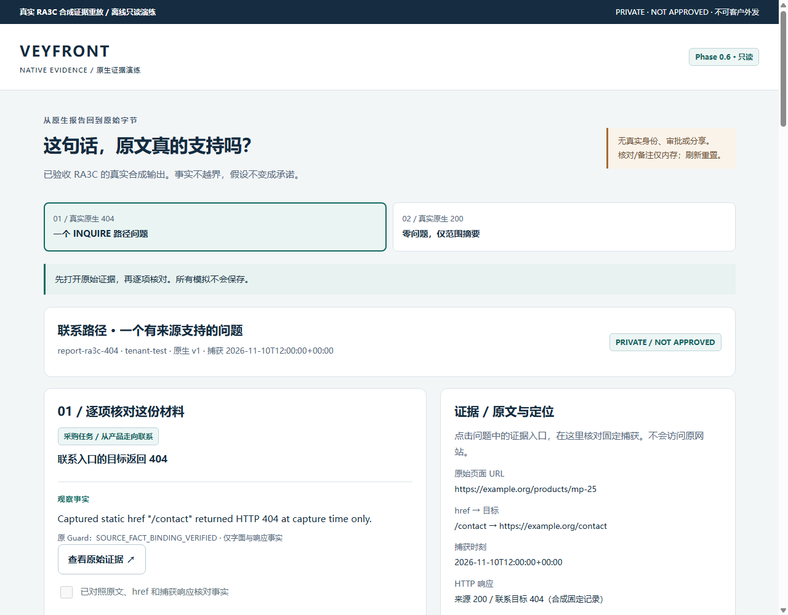
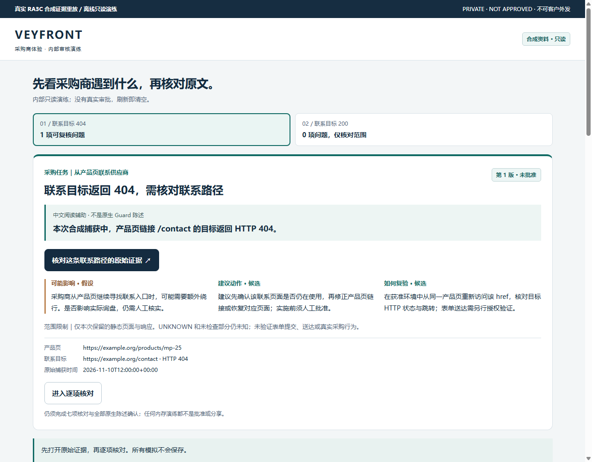
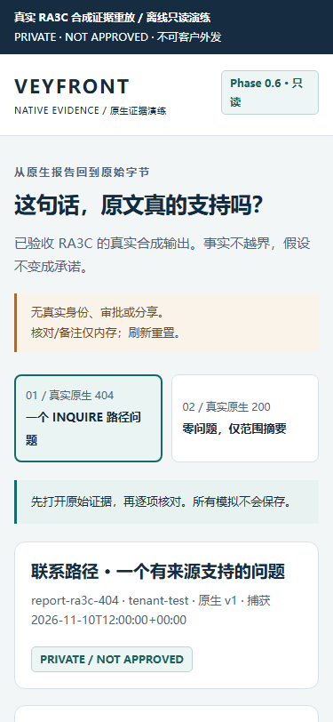
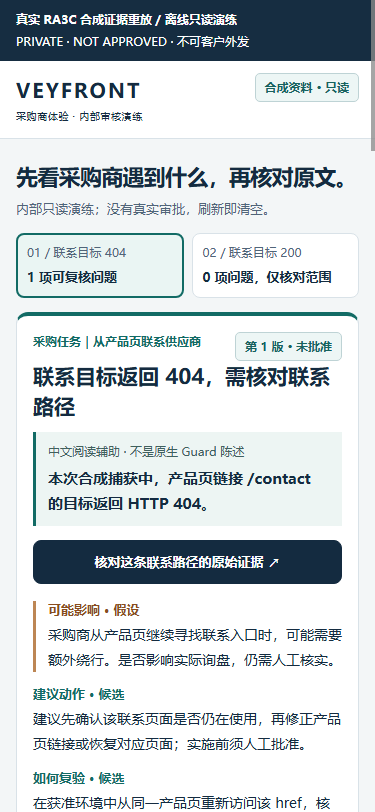
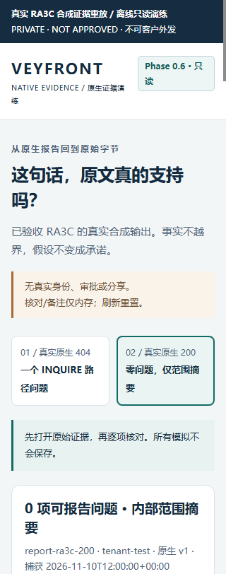
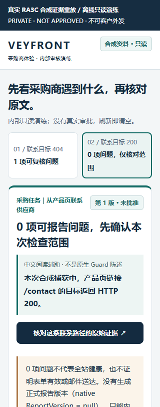

# 旧版 / 新版视觉审阅与操作说明

以下都是本轮新鲜 Chromium 的真实首屏，同为 1280×1000 或 375/320×812、deviceScaleFactor=1；旧版确实在 UI 修改前执行，未复用 PR54 的旧截图，也未重绘/拼接图片。完整 DOM、尺寸、哈希和操作日志见各原始 results。这里只评估信息呈现，不声称真人理解更快或审核耗时下降。

| 视图 | 本轮拍摄的已验收旧版 | 本轮拍摄的新版 |
| --- | --- | --- |
| 404 / 桌面 |  |  |
| 404 / 375 |  |  |
| 200 / 320 |  |  |

旧版从原生上下文和英文事实开始，审核者要先穿过报告 id、原生类型与较多工程资料。新版先回答“采购商要做什么、捕获时记录了什么、还不能断言什么”，把证据按钮紧跟在事实阅读辅助后。影响、动作、复验直接复用原生候选文字，标签保留“假设/候选”；不把它们升格为事实。

中文事实辅助明确标为非原生 Guard 陈述，只描述固定合成捕获中的 href 和 404/200 响应。原英文事实没有被翻译后覆盖。200 首屏明确 0 问题不代表网站健康、表单或邮件有效；ReportVersion 仍 null，不能批准一个不存在的报告。

完整原生资料现在默认折叠，减少默认扫描时的长 SHA/JSON/指针。点击展开仍可逐字核对原 English claim、quote、UTF-8 区间、Guard/binding/evidence/snapshot/source 引用和原始 HTML。展开后的真实技术视图：[1280](evidence/reviewer-browser-2026-11-12T10-57-30-395Z/P1-expanded-technical-404-1280.png) / [375](evidence/reviewer-browser-2026-11-12T10-57-30-395Z/P1-expanded-technical-404-375.png) / [320](evidence/reviewer-browser-2026-11-12T10-57-30-395Z/P1-expanded-technical-200-320.png)。折叠只改变阅读层级，不删除证据或放松审核。

建议演示：

1. 打开 [工作台](../index.html)，查看中文任务和“未批准”。404 辅助只说明捕获时返回 404，不能说当前网站一直不可用或已丢单。
2. 点击首屏证据按钮，核对原始捕获时间、URL/HTTP、精确 quote 和 UTF-8 [158,177)。返回后焦点回到摘要按钮，位置有可见环；也可用 Tab/Enter 操作。
3. 阅读影响假设/候选动作/复验，再进入原有七项核对。展开全部原生陈述，逐条回查与确认；本轮没有“全选”或自动确认。未完整核对时模拟仍阻断，完成后的二次确认仍仅内存演练。
4. 切换 200，解释 0 问题与未知范围，确认原生 null；刷新验证记录清空。

遗留问题：没有真实中文业务审核员参与理解率、错误率或耗时研究；没有真机/微信/完整读屏器验收。展开后仍有较长的原生资料和所有必要确认，移动阅读仍需滚动。中文事实辅助只覆盖本轮固定 404/200，不是通用翻译器或新 Guard。真实身份、可信全文绑定/事务/持久审计、任意人工改写合同及 Owner 分享仍未实施。没有把界面改善解释成销售、询盘或商业效果。

RA3D 生产仍需 Codex1 PR48 的 Owner FINAL PASS/合并和单独实施授权；本轮保持 Draft、不部署、不自行合并。
